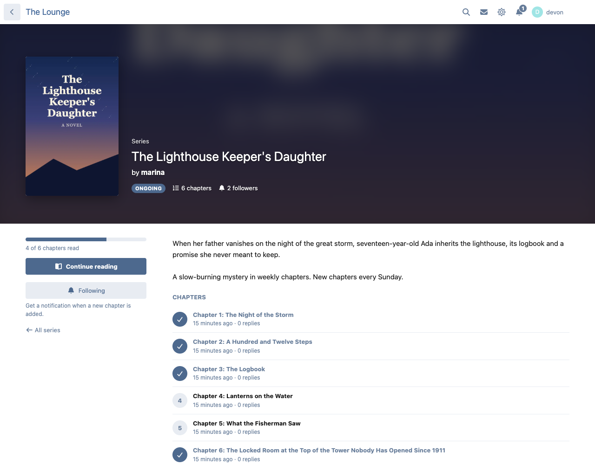
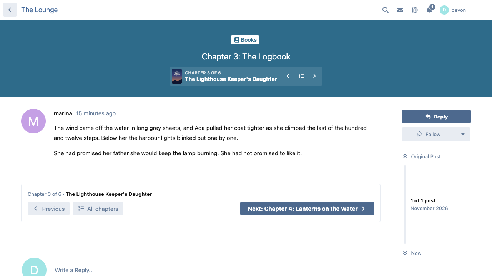
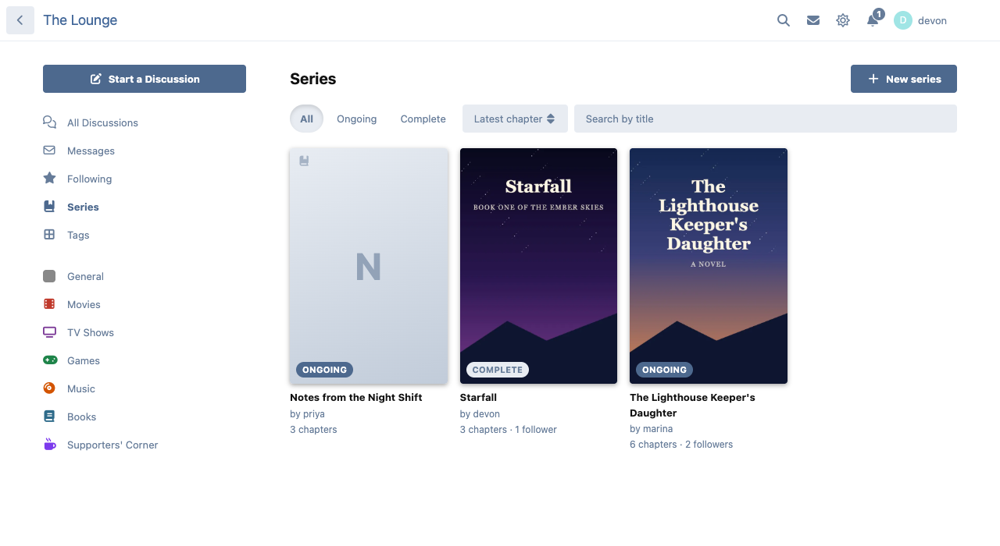
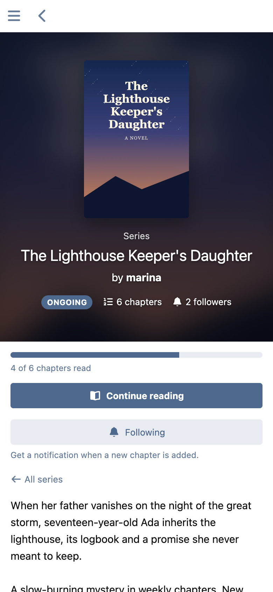

# Anthology

Group discussions into series: novels written chapter by chapter, serials, tutorial parts, devlogs. Every chapter stays an ordinary discussion with its own replies; Anthology adds a cover page with a table of contents, reading progress, previous and next on every chapter, and a notification to followers when a chapter is added.



## What it does

- **A page for each series** at `/series/…`: a large cover, the description, the chapters in order, and the reader's progress ("4 of 6 chapters read") with **Start reading** / **Continue reading**.
- **On every chapter**, under its title: "Chapter 3 of 6", the series, and previous / all chapters / next. After the chapter's text (its first post) a **Next chapter** button, before the replies.
- **Adding a chapter**: open a discussion you started, choose **Add to a series** in its menu, and pick one of your series or start a new one. It becomes the newest chapter. The same menu moves it to another series or takes it out.
- **Follow** a series to get a notification (and an email, if you want one) when a new chapter is added.
- **A directory** at `/series` with Ongoing / Complete, sorting by latest chapter, newest, most followed or title, and a title search. A **Series** tab on the profiles of members who have one.
- **The owner** edits the title, description, status and cover, reorders chapters and removes them from the series page.
- **Call it what fits your forum**: series, novel, story or book. Menus and buttons follow ("Add to a novel", "Novels").







## Privacy

Everything Anthology shows goes through Flarum's own discussion visibility. A chapter in a tag a reader can't open is not listed, counted, linked from the chapter before it or announced to them, and a series whose chapters they can't see doesn't exist for them.

Reading progress is Flarum's own record of which discussions a member has opened, so nothing new is stored while reading, and chapters read before Anthology was installed count too.

## Permissions

| Permission | Default |
| --- | --- |
| View series | Everyone |
| Start series and add own discussions as chapters | Members |
| Edit any series and add any discussion | Moderators |

Members can only add discussions they started, and only to their own series.

## Installation

```sh
composer require ernestdefoe/anthology
php flarum migrate
php flarum cache:clear
```

## Updating

```sh
composer update ernestdefoe/anthology
php flarum migrate
php flarum cache:clear
```

## Links

- [Source](https://github.com/ernestdefoe/anthology)
- [Buy me a coffee](https://buymeacoffee.com/ernestdefoe)
